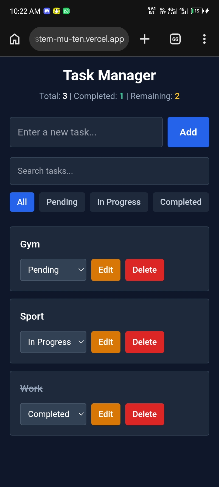
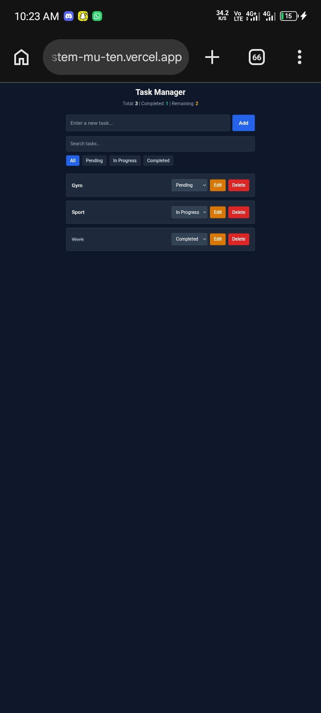

# Personal Task Management System

A responsive web-based Task Management System built with **React.js** and **Tailwind CSS** as part of my Software Development internship assignment. The application allows users to organize, track, and manage their daily tasks with automatic browser storage.

🔗 **Live Demo:** [View Live Application](https://task-management-system-mu-ten.vercel.app)

---

## Features

- **Add Tasks:** Create new daily tasks with input validation to prevent blank entries.
- **View & Monitor Progress:** View all tasks in a clean card layout alongside a live counter tracking Total, Completed, and Remaining tasks.
- **Inline Editing:** Edit existing task titles directly inside the task card and save or cancel changes.
- **Status Management:** Update task progress between **Pending**, **In Progress**, and **Completed** (with automatic strikethrough styling for completed tasks).
- **Delete Tasks:** Remove unwanted tasks from the list.
- **Search & Filter:** Search tasks in real time by keyword and filter tasks by status (**All**, **Pending**, **In Progress**, **Completed**).
- **Persistent Storage:** Automatically saves and loads tasks using browser `localStorage` so data stays intact after refreshing or closing the tab.
- **Responsive Design:** Adapts cleanly across mobile phones, tablets, and desktop screens.

---

## Technologies Used

- **React.js (Hooks: `useState`, `useEffect`)** – Component state management and lifecycle syncing
- **JavaScript (ES6+)** – Array methods (`.map()`, `.filter()`), arrow functions, and JSON serialization
- **HTML5 & Tailwind CSS** – Responsive dark-mode user interface styling
- **Vite** – Fast frontend build tool and development server
- **Browser LocalStorage API** – Client-side data persistence
- **Git & GitHub** – Version control and source code hosting
- **Vercel** – Continuous deployment and live hosting

---

## Screenshots

### Mobile View


### Desktop View


---

## How to Run Locally

If you want to run this project on a local computer:

1. **Clone the repository:**
   ```bash
   git clone [https://github.com/Femii11/Task-management-system.git](https://github.com/Femii11/Task-management-system.git)
   ```
2. **Navigate into the project folder:**
   ```bash
   cd Task-management-system
   ```
3. **Install dependencies:**
   ```bash
   npm install
   ```
4. **Start the development server:**
   ```bash
   npm run dev
   ```
5. Open the local URL shown in your terminal (usually `http://localhost:5173`).

---

## Key Concepts Learned

Building this project helped me move from static HTML/CSS to interactive React applications—specifically learning how `useState` updates the UI dynamically, how `.map()` and `.filter()` handle immutable state updates, and how `useEffect` syncs application state with `localStorage`.
